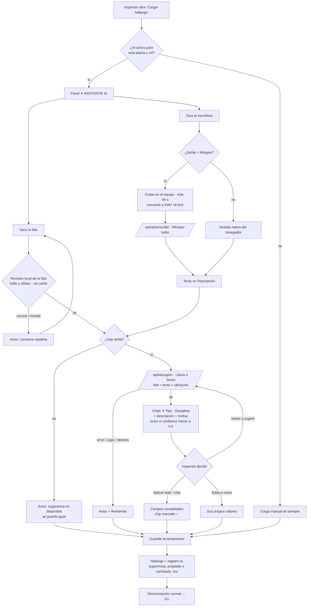
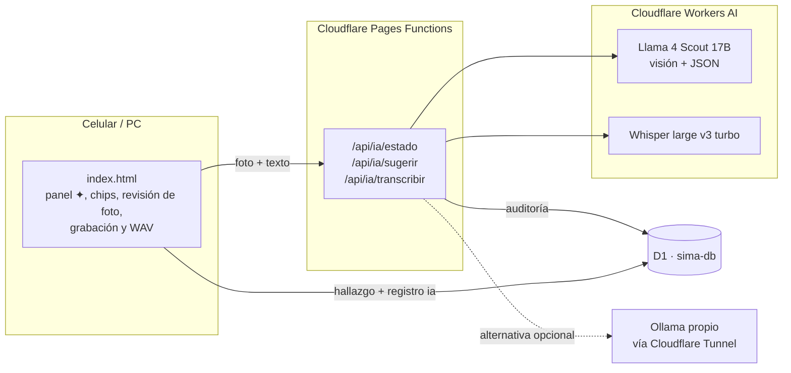
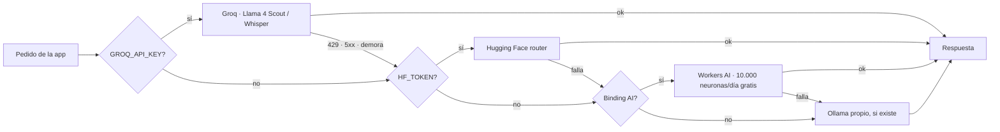

# SIMA · Asistente de IA para la carga de hallazgos

Versión 06-11-26 · Fase 1 (asistir la carga)

## Qué hace

Al cargar un hallazgo, el Inspector recibe ayuda de la IA:

1. **Sugerencia desde la foto:** apenas se saca la foto, Llama 4 (con visión) propone el **tipo** de hallazgo, la **disciplina** y una **descripción** técnica breve.
2. **Dictado con Whisper:** el micrófono graba en el equipo y Whisper transcribe en el servidor. Entiende mejor que el dictado del navegador cuando hay ruido de planta. Con el texto nuevo, la sugerencia se rehace sola.
3. **Revisión de la foto:** la app avisa si la foto está oscura, sobreexpuesta o movida. Corre en el celular, sin IA y sin señal.
4. **Registro de acierto:** con cada hallazgo queda guardado qué sugirió la IA y si el Inspector lo aceptó o lo cambió, para medir cuánto acierta.

## Reglas del sistema

| Regla | Cómo se cumple |
|---|---|
| **La IA sugiere y la persona decide** | Las sugerencias aparecen como chips con borde punteado y ✦. Nada se completa solo: se toca cada chip o **Aplicar todo**. |
| **Nunca bloquea** | Si no hay señal, no hay cupo o la IA falla, se muestra un aviso y el hallazgo se carga y se guarda como siempre. |
| **Sólo el Inspector** | `/api/ia/*` rechaza a los demás roles (403) y a los usuarios sin sesión (401). |
| **Separación por planta** | Sólo funciona en las plantas habilitadas para el usuario y en `IA_PLANTAS`. |
| **Trazabilidad** | Cada uso queda en la auditoría (`ia-sugerir`, `ia-transcribir`) con modelo, resultado, confianza y tiempo. |

## Diagrama de flujo



## Componentes



## Qué se necesita para activarlo

1. **El binding de Workers AI.** Ya viene en `wrangler.toml` (`[ai] binding = "AI"`). Cloudflare lo toma solo al publicar: no hay que configurar nada en el panel ni crear claves.
2. **Publicar la versión** (GitHub → Cloudflare Pages, como siempre).
3. **Nada en la base de datos:** la columna `ia` de `levantamientos` se agrega sola la primera vez que alguien abre la app.

Variables opcionales (Pages → Settings → Variables and Secrets):

| Variable | Para qué | Por defecto |
|---|---|---|
| `IA_DESACTIVADA` | `1` apaga el asistente sin tocar el código | — |
| `IA_PLANTAS` | Limita las plantas, por ejemplo `planta8` | todas |
| `IA_MODELO` | Cambia el modelo de visión | `@cf/meta/llama-4-scout-17b-16e-instruct` |
| `WHISPER_MODELO` | Cambia el modelo de voz | `@cf/openai/whisper-large-v3-turbo` |
| `IA_PROVEEDOR` + `OLLAMA_URL` … | Usar un servidor propio con Ollama en vez de Workers AI | — |

## Proveedores gratuitos: Groq primero, Cloudflare de respaldo (07-11-26)

**¿Hugging Face gratis?** Ya no alcanza. Desde 2025 sus *Inference Providers* cobran por uso. La página oficial de precios indica que la cuenta gratuita no trae créditos («Free Users · None»). La cuenta PRO cuesta USD 9 por mes e incluye USD 2 de créditos. Por eso SIMA lo deja como opción (`HF_TOKEN`), pero no como camino principal.

**La alternativa gratis de verdad es Groq** (console.groq.com). La clave se crea sin tarjeta y su API es compatible con la de OpenAI. Ofrece los mismos modelos que usa SIMA:

- `meta-llama/llama-4-scout-17b-16e-instruct`, con visión (lee la foto) y modo JSON.
- `whisper-large-v3-turbo` para el dictado.

El plan gratis tiene límites por minuto y por día. Al pasarlos, Groq responde 429 y no cobra nada.

**Cómo funciona la cadena.** El servidor (`llamarIA()` en `functions/api/[[path]].js`) prueba los proveedores en este orden: **Groq → Hugging Face → Workers AI → Ollama**. Solo entran los que están configurados.

- Si uno falla (cupo agotado, 429, error 5xx o demora de más de 20 s), pasa al siguiente sin que el usuario lo note.
- El dictado sigue su propia cadena: **Groq → Workers AI → WHISPER_URL**.
- La auditoría registra qué proveedor respondió cada vez, por ejemplo `ia-sugerir · Groq meta-llama/... · puerta/mecanico · ubic · conf 0.86 · 1200 ms`.



**Activarlo, sin usar la terminal:**

1. En console.groq.com, entrá con tu cuenta de Google y andá a **API Keys → Create API Key**. Copiá la clave: empieza con `gsk_`.
2. En Cloudflare, abrí **Workers & Pages → sima → Settings → Variables and Secrets → Add**.
   - Tipo: **Secret**.
   - Nombre: `GROQ_API_KEY`.
   - Valor: la clave que copiaste.
   - Guardala en **Production**.
3. Volvé a desplegar: **Deployments → … → Retry deployment**, o hacé un push.
4. Para comprobarlo, cargá un hallazgo con IA. En D1, la tabla `auditoria` tiene que mostrar «Groq» en la acción `ia-sugerir`.

El binding de Workers AI queda como respaldo automático. No hay que tocarlo.

| Variable | Para qué | Por defecto |
|---|---|---|
| `GROQ_API_KEY` (secreta) | Activa Groq como proveedor principal | — |
| `GROQ_MODELO` / `GROQ_WHISPER` | Cambia los modelos de Groq | `meta-llama/llama-4-scout-17b-16e-instruct` / `whisper-large-v3-turbo` |
| `HF_TOKEN` (secreta) | Activa Hugging Face (requiere créditos) | — |
| `HF_MODELO` | Modelo en Hugging Face | `meta-llama/Llama-4-Scout-17B-16E-Instruct` |
| `IA_PROVEEDOR` | Fuerza cuál va primero (`groq`, `huggingface`, `workers-ai`, `ollama`) | Groq si hay clave |

## La IA también propone el SECTOR (07-11-26)

Si al pedir la sugerencia no hay ubicación elegida y hay texto, la app manda la lista de ubicaciones de la planta, numerada (como máximo 300). Llama devuelve el número de la ubicación que se nombró, o 0 si no se nombró ninguna o hay dudas. El servidor valida ese número y lo devuelve como `sug.ubic`, el índice de la ubicación o −1.

La regla del prompt es explícita: **nunca adivinar la ubicación por la foto**.

Sin señal o sin IA, la app propone lo mismo **por palabras** (`sugerenciaLocal()`):

- **Tipo:** por palabras clave, por ejemplo «luz», «lámpara» o «tubo» proponen *Luminaria*.
- **Sector:** cuando todas las palabras de un subsector aparecen en el texto. Los números se reconocen escritos o en cifras («dos» o «2»).

Si hay empate, no se propone nada.

## Costo

Workers AI tiene un cupo gratis de **10.000 neuronas por día**. El cupo se reinicia a las 00:00 UTC, que son las 21:00 en Paraguay. Pasado ese cupo, el plan pago cobra USD 0,011 cada 1.000 neuronas.

- Whisper consume unas 41 neuronas por minuto de audio, así que el cupo alcanza para varias horas de dictado por día.
- Llama 4 Scout con foto consume bastante más que el texto. Antes de estimar el costo mensual conviene medir unos días de uso real en el panel (Workers AI → Analytics).
- Con el plan gratuito, al agotarse el cupo la app muestra «Se agotó el cupo diario de IA» y se sigue cargando a mano.

## Cómo medir si sirve

Cada hallazgo cargado con ayuda de la IA guarda en la columna `ia` qué sugirió el modelo y si se aceptó. En la consola de D1:

```sql
SELECT
  COUNT(*) AS con_ia,
  ROUND(AVG(json_extract(ia,'$.acepto.cat')  = 1)*100) AS pct_tipo_aceptado,
  ROUND(AVG(json_extract(ia,'$.acepto.disc') = 1)*100) AS pct_disciplina_aceptada,
  ROUND(AVG(json_extract(ia,'$.acepto.desc') = 1)*100) AS pct_descripcion_aceptada,
  ROUND(AVG(json_extract(ia,'$.ms'))/1000.0, 1)        AS segundos_promedio
FROM levantamientos WHERE ia IS NOT NULL;
```

Si el tipo aceptado queda por debajo del 60 % después de un par de semanas, conviene probar otro modelo con `IA_MODELO` o ajustar las instrucciones del modelo (`PROMPT_IA` en `functions/api/[[path]].js`).

## Próximas fases

- **Fase 2:** detección de hallazgos parecidos ya abiertos (embeddings), resumen automático en el PDF de la ruta y ayuda al Inspector para comparar el antes y el después.
- **Fase 3**, con meses de historial: ranking de recurrencia y riesgo por sector, y consultas en lenguaje natural de sólo lectura.

## Pruebas realizadas (06-11-26)

- **API:** 17 pruebas con la API real, D1 sobre SQLite y Workers AI simulado. Cubren la sugerencia con foto, el modo JSON con reintento, el cupo agotado, los permisos por rol y planta, la foto SVG rechazada, Whisper, `IA_DESACTIVADA` y la auditoría.
- **Navegador:** 25 pruebas con `wrangler pages dev`, D1 local y Playwright, en 390 px y 1366 px. Cubren la sugerencia automática al sacar la foto, que nada se aplica solo, **Aplicar todo**, el registro `ia` sincronizado a D1, el aviso de foto oscura y el dictado con micrófono → WAV → Whisper → nueva sugerencia. No hubo errores de JavaScript.
- **Pendiente de verificar en producción:** la llamada real a Llama 4 Scout y a Whisper en la cuenta de Cloudflare (las pruebas usaron un modelo simulado) y la calidad de las sugerencias con fotos reales de planta.
