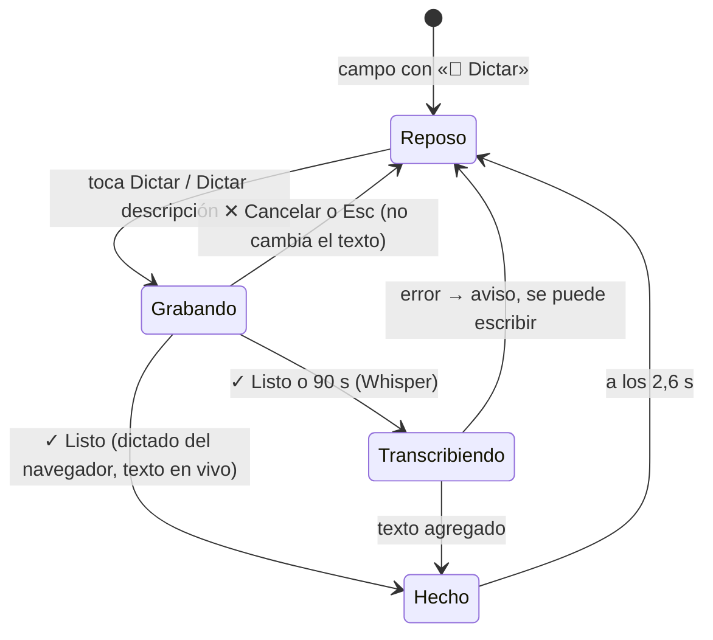
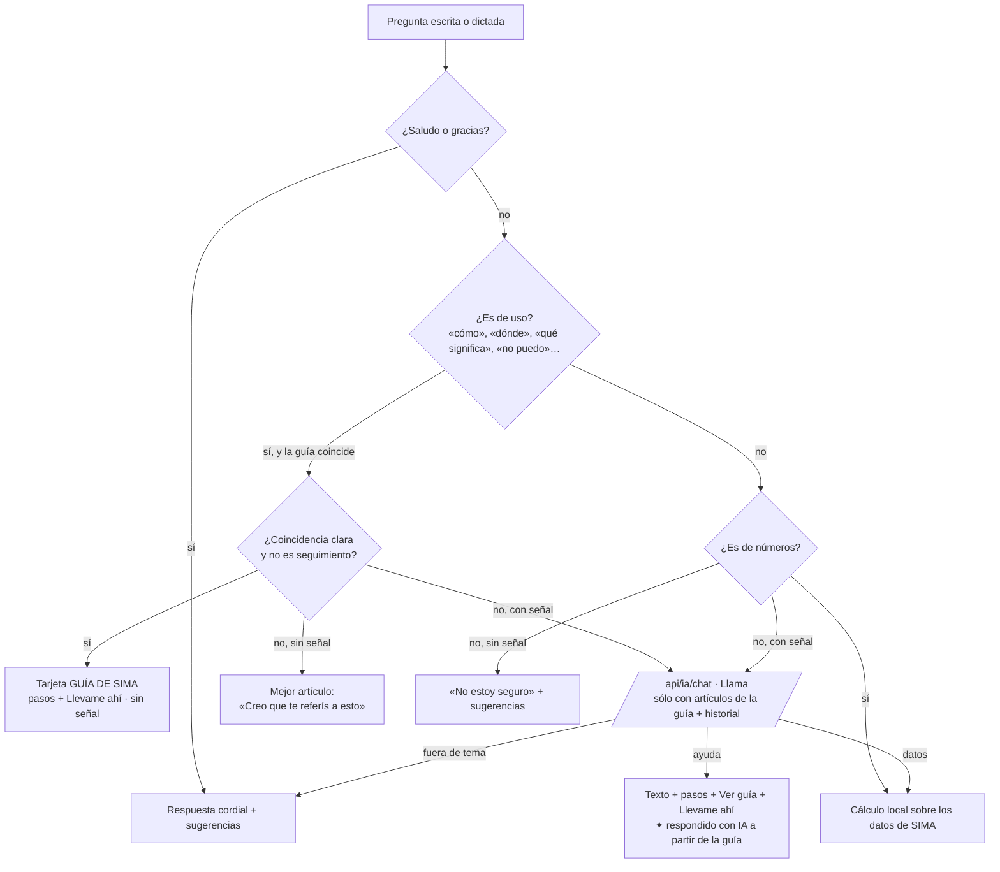
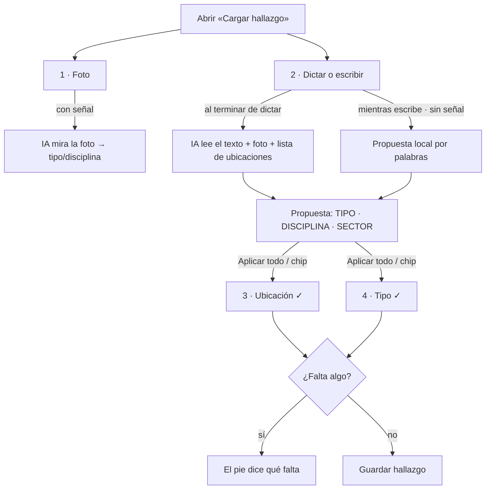
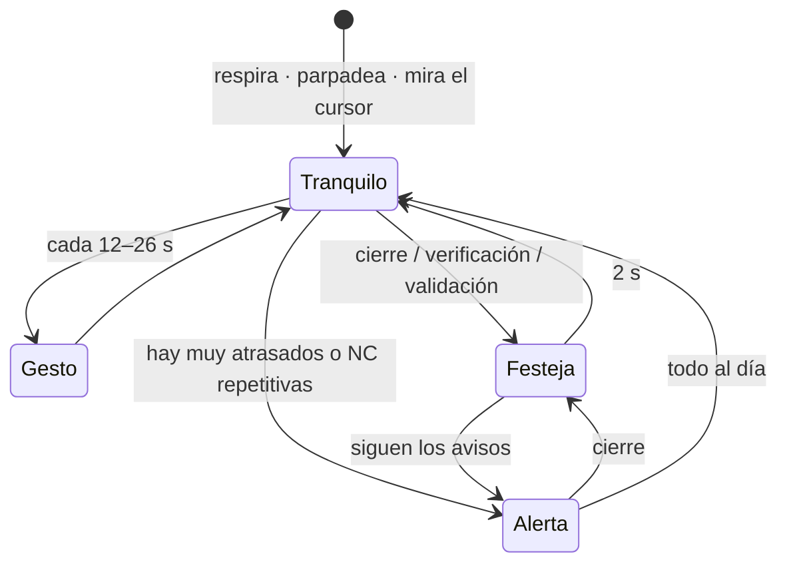
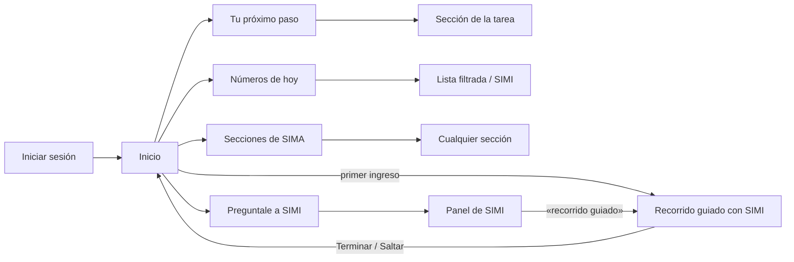

# SIMA · SIMI (asistente) y dictado por voz — diseño UX/UI

Versión 06-11-26

## 1. Diagnóstico de fricción (antes)

| Punto | Problema | Heurística afectada |
|---|---|---|
| Dictado | Micrófono de 24 px, sin texto, escondido en la etiqueta «DESCRIPCIÓN», al final del formulario | Visibilidad, reconocimiento antes que recuerdo, Fitts (objetivo chico y lejano) |
| Dictado | Al grabar sólo cambiaba de color el ícono: no había tiempo, nivel de voz ni una salida clara | Visibilidad del estado del sistema, control y libertad |
| Dictado | No había forma de descartar lo grabado | Control y libertad, prevención de errores |
| Consultas | Para saber «cuántos hay en Área Fría» había que ir a la lista, filtrar y contar | Flexibilidad y eficiencia, carga cognitiva |
| Acompañamiento | Al entrar no había un resumen de lo pendiente según el rol | Visibilidad del estado, reconocimiento |

## 2. Referencias del mercado

- **WhatsApp, ChatGPT y Gemini:** el micrófono está dentro del campo, abajo a la derecha. Al grabar, la barra pasa a modo grabación con tiempo, nivel de voz, ✕ y ✓.
- **Google Keep y Gboard:** el dictado es un botón grande, con texto, a un toque del pulgar.
- **Intercom, Zendesk y HubSpot:** asistente en un botón flotante abajo a la derecha. En PC abre un panel que no tapa la pantalla; en el celular, una hoja inferior.
- **Material 3 y Apple HIG:** hoja inferior en el celular con manija, que se cierra deslizando hacia abajo. Botones de al menos 44 px y foco visible.
- **Duolingo y Clippy (como antiejemplo):** una mascota da cercanía, pero no debe interrumpir. SIMI aparece sólo una vez con un globo que se cierra solo; después espera a que la llamen.

## 3. Recomendaciones aplicadas

### Dictado (todos los campos con voz)
- **Botón grande:** «🎤 Dictar» de 46 px dentro del campo, abajo a la derecha, en ámbar de marca, con el texto «Escribí o tocá Dictar y hablá».
- **Atajo arriba:** en el formulario de carga, el panel ✦ (junto a la foto) tiene **Dictar descripción**. Lleva al campo y empieza a grabar sin buscarlo al final.
- **Estados visibles:**
  - **Grabando:** borde rojo, punto que late, tiempo (con el máximo en los últimos 15 s), nivel real del micrófono, **✕ Cancelar** y **✓ Listo**.
  - **Transcribiendo:** indicador de espera.
  - **Listo:** «✓ Texto agregado · revisalo antes de guardar».
- **Control:** Esc o ✕ cancelan sin tocar lo que ya estaba escrito. Al cerrar el formulario se corta la grabación.
- **Motor:** Whisper (con señal) o el dictado del navegador (sin señal). La interfaz es la misma en los dos casos.
- **Accesibilidad:** anuncios con `aria-live`, el foco pasa a «Listo» al grabar, vibración corta al empezar y al terminar, y respeta «reducir movimiento».

### SIMI
- **Mascota propia:** el cubo hexagonal del logo de SIMA con visor y ojos celestes. Parpadea, «piensa» mientras calcula y sonríe cuando todo está al día.
- **Siempre a mano:** botón flotante en todas las pantallas.
  - **PC:** pastilla «Preguntale a SIMI», abajo a la derecha. **Ctrl + /** la abre y la cierra.
  - **Celular:** círculo de 58 px sobre la barra de pestañas, sin taparla. Los avisos y el final de la página se corren para no quedar debajo.
- **Acompañamiento:** al abrir saluda por el nombre y resume según el rol, con tarjetas que se pueden tocar:
  - **Inspector:** abiertos, por programar, a verificar y los que llevan más de 30 días.
  - **Técnico:** sus trabajos por hacer y en ejecución.
  - **Calidad:** los que quedan por validar.
- **Ley de Hick:** se ofrecen 4 preguntas sugeridas como máximo, que cambian según la respuesta anterior.
- **Respuestas accionables:**
  - Cada barra se puede tocar para profundizar, por ejemplo área → tipos de esa área.
  - Cada hallazgo antiguo abre su detalle.
  - **Ver en la lista** abre la lista con los filtros ya aplicados.
- **Voz:** el micrófono de SIMI usa el mismo dictado. La pregunta dictada se envía sola.
- **Confianza:** todas las cifras las calcula SIMA con los datos que el usuario puede ver. Si la IA interpretó la pregunta, la respuesta lo dice («✦ pregunta interpretada con IA · cifras calculadas por SIMA»).

## 4. Flujo de SIMI

```mermaid
flowchart TD
  A[Botón SIMI · siempre visible<br/>o Ctrl + /] --> B[Panel: PC flotante · celular hoja inferior]
  B --> C[Saludo + resumen según rol<br/>tarjetas tocables]
  C --> D{Usuario}
  D -- toca sugerencia o tarjeta --> Q[Consulta estructurada]
  D -- escribe --> P[Reglas locales<br/>funcionan sin señal]
  D -- dicta --> V[Whisper / dictado nativo] --> P
  P -- entendida --> Q
  P -- no alcanza y hay señal --> IA[/api/ia/consulta · Llama<br/>sólo intención y filtros, sin datos/]
  IA --> Q
  P -- sin señal o sin entender --> X[«No estoy seguro» + 4 sugerencias]
  Q --> K[Cálculo local sobre L()<br/>planta activa + permisos del rol]
  K --> R[Respuesta: texto + barras / lista / tarjetas]
  R --> R1[Tocar barra → profundizar]
  R --> R2[Tocar hallazgo → detalle]
  R --> R3[Ver en la lista → filtros aplicados]
  R --> R4[Nuevas sugerencias]
```

## 5. Flujo del dictado



## 6. Lo que pregunta SIMI (ejemplos)

- «¿Cuántos hallazgos abiertos de puertas hay?»
- «¿Qué área tiene más hallazgos?» y después tocar la barra para ver sus tipos.
- «¿Qué sector tiene más en Área Fría este año?»
- «¿Cuáles son los más antiguos sin cerrar?»
- «¿Cómo están por estado?» / «Resumen»
- «¿Cuántos se cerraron este mes?» / «¿Cuántos a validar?»

## 7. Pruebas (06-11-26)

- **API:** 21 pruebas, entre ellas `/api/ia/consulta` (valores fuera de lista descartados) y los permisos por rol: cualquiera dicta y le pregunta a SIMI, sólo el Inspector pide sugerencias.
- **Navegador:** 41 pruebas con Playwright en 390 px y 1366 px. Revisan el tamaño del botón y que no tape la barra, el saludo con cifras correctas, el ranking y el drill-down, los filtros combinados, los antiguos con su detalle, la IA de respaldo marcada, la voz con envío automático, **Ver en la lista**, Esc, Ctrl + / y el dictado (botón de 46 px, grabación, transcripción, cancelación con Esc). No hubo errores de JavaScript.
- **Pendiente en producción:** probar la voz y SIMI con usuarios en planta (ruido, guantes) y ajustar las sugerencias según las preguntas reales (quedan en la auditoría como `ia-consulta`).

---

# SIMI conversacional — ayuda de uso (07-11-26)

## 1. Diagnóstico: cómo funcionaba hasta ahora

| Aspecto | Antes | Problema |
|---|---|---|
| Qué respondía | Sólo números: cantidades, rankings, antiguos, por estado | Ante «¿cómo programo un trabajo?» contestaba con un conteo o con «no entendí» |
| Cómo entendía | Reglas de palabras clave de datos; cualquier mención de un tipo o período disparaba un conteo | «¿Cómo cargo un hallazgo de puerta?» devolvía «Hay N hallazgos de tipo Puerta» |
| Llama | Sólo traducía la pregunta a una consulta de datos | No servía para explicar el uso del sistema |
| Contexto | Cada pregunta aislada | No entendía seguimientos como «¿y si no aparece el técnico?» |
| Encabezado | Punto verde y antena titilando | Distraía y se veía poco profesional |

## 2. Qué cambió

- **Guía de uso (`public/sima-ayuda.js`):** 26 artículos con los pasos tal como aparecen en SIMA: botones, pantallas y quién lo hace. Cubre recorrido, carga, sector sin novedad, cierre y planificación de la ruta, programar, fecha tentativa, orden SAP, iniciar y cerrar trabajo, verificación, control de Calidad, estados, arrastre, edición, PDF, Excel, dictado, IA, sin señal, plantas, usuarios, estructura, filtros y sesión. Para corregir una respuesta se edita ese archivo.
- **Búsqueda local** en la guía: funciona sin señal y responde al instante. Reconoce variantes («asigno» → programar, «termino» → cerrar, «falla» → hallazgo).
- **Llama con la guía (`/api/ia/chat`):** cuando la pregunta es ambigua, de seguimiento o no está en la guía, Llama redacta la respuesta usando **sólo** los artículos encontrados y los últimos mensajes de la conversación. Si la guía no lo cubre, lo dice y sugiere consultar al administrador. No inventa botones ni pantallas.
- **Cifras confiables:** si Llama detecta que la pregunta es de números, no da cifras: devuelve la consulta y SIMA la calcula con sus datos.
- **Rol del usuario:** si un técnico pregunta algo que hace el Inspector, SIMI se lo explica, avisa «Esto lo hace el Inspector» y no ofrece «Llevame ahí».
- **Respuestas accionables:** tarjeta «GUÍA DE SIMA» con pasos numerados, nombres de botones resaltados, una nota y **Llevame ahí** a la pantalla correcta. Debajo, sugerencias de temas relacionados.
- **Sugerencias por rol:**
  - Inspector: recorrido, programar, área con más hallazgos y los más antiguos.
  - Técnico: cerrar e iniciar trabajos y sus pendientes.
  - Calidad: control final, cantidad a validar y PDF.
- **Encabezado sobrio:** se quitaron el punto verde y la antena titilante dentro del panel. La animación queda sólo en el botón flotante.

## 3. Flujo de una pregunta



## 4. Pruebas (07-11-26)

- **API:** 27 pruebas, 6 de ellas nuevas para `/api/ia/chat`:
  - artículos no enviados descartados;
  - la guía y el historial llegan al modelo;
  - rol y pantalla informados;
  - en preguntas de números devuelve la consulta, sin cifras;
  - sin sesión responde 401.
- **Navegador:** 38 pruebas en celular y PC. Revisan:
  - que no haya punto verde ni antena titilante en el panel;
  - las sugerencias mixtas y las guías locales («cómo programo», «cómo cierro el recorrido», «qué es un arrastrado»);
  - que un seguimiento ambiguo se responda con IA y que los números se resuelvan como datos;
  - que «¿cómo cargo un hallazgo de puerta?» dé la guía y no un conteo;
  - preguntas fuera de tema y «gracias»;
  - **Llevame ahí** y el modo sin señal;
  - el rol técnico: sugerencias propias, aviso de rol y sin «Llevame ahí» para tareas de otro rol.
- **Selección de artículos:** 22 preguntas reales formuladas de distintas maneras llevan al artículo correcto.
- **Sin regresiones:** las 41 pruebas de SIMI y dictado y las 25 de la carga con IA siguen pasando.
- **Pendiente en producción:** la calidad de las respuestas de Llama con preguntas reales. Cada consulta queda en la auditoría como `ia-chat`, con los artículos usados, para ajustar la guía.


# Carga de hallazgo — rediseño (07-11-26)

## Diagnóstico de fricción (antes)

| Problema | Heurística / ley | Efecto |
|---|---|---|
| Foto vacía ocupaba media pantalla (500 px en PC) | Estética y diseño minimalista | El formulario quedaba debajo del pliegue |
| Lista de 40+ ubicaciones abierta, con el área repetida en cada fila | Ley de Hick, carga cognitiva | Había que hacer scroll largo para llegar al tipo |
| 14 tarjetas de tipo de 80 px de alto (5 filas) | Ley de Hick | Unos 400 px solo para elegir el tipo |
| Descripción y dictado al final, después de todo | Flexibilidad y eficiencia | El dictado, la forma más rápida, quedaba último |
| La IA proponía tipo y disciplina, pero no el sector | Prevención de errores | El sector, lo más propenso a error, quedaba a mano |
| «Guardar» gris sin explicar por qué | Visibilidad del estado del sistema | El usuario no sabía qué le faltaba |

## Referencias de la industria

- **SafetyCulture (iAuditor), «Create issue»:** pasos cortos con evidencia primero y campos que se marcan como completos.
- **Procore Observations:** foto a la izquierda y formulario a la derecha en escritorio; tipo y ubicación con selector buscable.
- **Fulcrum / ArcGIS Field Maps:** la ubicación elegida se resume en una línea con «Cambiar»; el buscador se abre solo para cambiarla.
- **Material 3:** *filter chips* para elegir entre muchas opciones cortas, y *segmented button* para 4 opciones.

## Qué cambió

1. **4 pasos numerados**, cada uno en su tarjeta: **1 Foto · 2 Contá qué encontraste · 3 Ubicación · 4 Tipo y disciplina**.
   - El número pasa a ✓ verde al completarse, con un resumen a la derecha (por ejemplo «Puerta · Mecánico»).
   - Debajo del título hay una barra de progreso de 4 segmentos.
2. **El dictado pasa al paso 2**, arriba. El texto de ejemplo enseña a nombrar el sector: «Fisura en la pared de la cámara de oreo 2…».
3. **«Propuesta de SIMA»** debajo de la descripción, con chips de **TIPO · DISCIPLINA · SECTOR**.
   - Hay un botón **Aplicar todo**, y cada chip también se puede aplicar por separado.
   - Nada se aplica solo.
   - Con IA, la propuesta muestra el tiempo de respuesta y el motivo.
   - Sin IA o sin señal, propone «por palabras».
   - Si la IA no reconoce el sector, lo dice y sugiere nombrarlo al dictar.
4. **La ubicación elegida se resume en una tarjeta** con área, sector y subsector y un botón **Cambiar**.
   - Abajo está «Marcar «Oreo» sin novedad» cuando hay un recorrido en curso.
   - Sin ubicación elegida aparecen dos atajos arriba del buscador: la **propuesta por IA o por la descripción** y la **última ubicación usada en este recorrido**. Se tocan para elegirlos; nunca quedan preseleccionados.
   - La lista se agrupa por área, con el encabezado fijo.
   - El buscador acepta varias palabras («oreo 2»).
5. **El tipo se elige con chips** de 40 px en lugar de las tarjetas. La disciplina, con 4 botones segmentados.
6. **El pie dice qué falta** («Falta la foto, la ubicación y el tipo») y cambia a «✓ Listo para guardar».
7. **En la PC** (≥ 960 px) el modal pasa de 720 a 1040 px, con la foto fija a la izquierda y los pasos a la derecha.
8. **Sin foto**, el recuadro es compacto, con «Abrir cámara» como acción principal.



## Pruebas (07-11-26)

- `prueba-ia.mjs`: 39 pruebas de la API con proveedores simulados. Cubren Groq, el respaldo ante 429, el reintento sin modo JSON, Hugging Face, el índice de ubicación validado y la voz por Groq con respaldo en Workers AI.
- `e2e-captura.py`: 41 pruebas en 390 y 1366 px.
  - Pasos, progreso y qué falta.
  - Propuesta local y propuesta de la IA con sector.
  - «Cambiar», buscador por palabras, «sin novedad» y atajo de la última ubicación.
  - Guardado con registro de qué se aceptó.
  - Funcionamiento sin señal.
- Siguen pasando `e2e.py`, `e2e-simi.py` y `e2e-chat.py`. Este último se actualizó: con señal, las preguntas de uso las responde Llama con la guía.

# Portada de SIMA y SIMI con vida (07-11-26)

## Diagnóstico de fricción (antes)

| Problema | Heurística / principio | Efecto |
|---|---|---|
| Un login suelto en el centro de una pantalla vacía | Reconocimiento antes que recuerdo; primera impresión | No decía qué es SIMA ni para qué sirve |
| Sin mostrar la contraseña ni aviso de Bloq Mayús | Prevención de errores | Errores de tipeo sin pista |
| Error sólo en texto rojo chico | Visibilidad del estado | Fácil de pasar por alto |
| SIMI quieto en un botón | Diseño emocional | No transmitía «asistente que acompaña» |
| Nada avisaba de trabajos muy atrasados ni de NC que vuelven | Visibilidad del estado; prevención | La reincidencia se descubría tarde |

## Referencias de la industria

- **Portadas de producto con acceso** (Linear, Notion, SafetyCulture): la marca y la promesa a la izquierda, el acceso a la derecha.
- **Mascota que reacciona al login:** el patrón del «yeti» de los formularios animados. Mira lo que escribís, se tapa los ojos con la contraseña y espía si la mostrás.
- **Duolingo:** mascota con micro-reacciones al logro y al error, sin bloquear la tarea.
- **Material 3 y WCAG 2.1:** campos de 48 px de alto, botón «mostrar contraseña» con `aria-pressed`, errores con `role="alert"` y respeto de «reducir movimiento».

## Qué cambió

**Portada**
- En la PC se divide en dos:
  - A la izquierda: la marca, SIMI grande con un globo de diálogo, la frase «Ninguna no conformidad se cierra *sin evidencia*» y los 3 pasos del circuito (Detectá · Corregí · Validá).
  - A la derecha: «Iniciá sesión».
- En el celular, SIMI y su globo quedan arriba del formulario.

**SIMI en la portada**
- Saluda al abrir la pantalla.
- Sigue el cursor con los ojos.
- Mientras escribís el correo, mira el texto y te llama por el nombre de usuario.
- Se tapa los ojos con la contraseña y espía si tocás «mostrar».
- Se preocupa ante un error: cejas, antena roja y el motivo en el globo.
- Festeja al entrar.
- Avisa si te quedás sin señal.

**Acceso**
- Íconos en los campos y botón para mostrar u ocultar la contraseña.
- Aviso de Bloq Mayús.
- Enter envía el formulario.
- Ayuda para quien olvidó la contraseña y la leyenda «Funciona sin señal en cámaras de frío».

**SIMI con vida** (`public/sima-mascota.js`, un solo dibujo y un solo motor de animación)
- Respira y parpadea a intervalos irregulares.
- Cada 12 a 26 s hace un gesto: mira a un costado, mueve la antena, saluda o da un saltito.
- En la PC sus ojos siguen el cursor, sólo con mouse.
- Con «reducir movimiento» del sistema operativo no se mueve: sólo cambia la cara.

**Festejo de cierres**
- Al registrar el cierre de Mantenimiento, al verificar y cerrar como Inspector o al validar como Calidad, SIMI salta dos veces con las manos arriba.
- Suelta confeti con los colores de SIMA y muestra un globo con el logro.

**Alertas**
- **Muy atrasado** es cualquiera de estos casos:
  - Fecha tentativa vencida hace más de 7 días.
  - Programado hace más de 3 días y sin iniciar.
  - Más de 45 días abierto sin fecha tentativa.
- **NC repetitiva:** 3 o más del mismo tipo en el mismo punto en 120 días.
- **Cómo se ve:**
  - El botón de SIMI muestra cara de alerta, la antena roja y un número.
  - Una vez por día, o antes si los números suben, aparece «SIMI te avisa» con «Ver atrasados» y «Ver repetidas».
  - Al cargar un hallazgo que sería el 3.º en el mismo punto, aparece un aviso. En el detalle, una nota de «No conformidad repetitiva».

**«¿Cómo se repara?»** (`public/sima-reparar.js`, 12 fichas)
- Ejemplos de preguntas: «¿cómo reparo una gotera en el techo?» o «¿qué hago para que la puerta no se desprenda tan seguido?».
- La respuesta trae causas probables, pasos, seguridad e inocuidad y cómo evitar que se repita.
- Con señal responde Llama a partir de las fichas. Sin señal muestra la ficha guardada.
- Desde el detalle de un hallazgo abierto se llega con el botón «¿Cómo se repara? Preguntale a SIMI».



## Pruebas (07-11-26)

- `e2e-vivo.py`: 45 pruebas en 1366 y 390 px. Cubren:
  - Portada: SIMI que sigue el cursor, se tapa los ojos, espía, reacciona al error y festeja al entrar con Enter.
  - Dentro de la app: SIMI con vida, alerta con número y aviso, lista de atrasados y de repetidas.
  - Reparación con IA y sin señal, y que una pregunta de números siga siendo de datos.
  - Festejo con confeti, aviso de reincidencia al cargar, y detalle con nota y botón de SIMI.
- `prueba-ia.mjs`: 42 pruebas, ahora con reparación y fichas.
- Siguen pasando `e2e.py`, `e2e-simi.py`, `e2e-chat.py` y `e2e-captura.py`.

# Inicio y recorrido guiado con SIMI (09-11-26)

## Diagnóstico de fricción (antes)

| Problema | Heurística / ley | Efecto |
|---|---|---|
| Se entraba directo a «Inspección»: una tarjeta de ruta y más de 40 hallazgos con foto | Visibilidad del estado; reconocimiento antes que recuerdo | No quedaba claro qué hacer primero ni qué hay en el resto de SIMA |
| En la PC el menú es una columna de íconos sin nombre | Reconocimiento antes que recuerdo | Hay que adivinar qué es cada ícono |
| Los pendientes estaban repartidos entre insignias del menú, la campanita y cada pantalla | Ley de Hick; carga cognitiva | No había un lugar que resumiera «lo mío de hoy» |
| La bienvenida de SIMI era un globo que se iba a los 9 s | Ayuda y documentación | No enseñaba a moverse por SIMA |

## Pros y contras de sumar un Inicio

**A favor**
- Orienta a quien entra por primera vez o de vez en cuando (Calidad, supervisores, el usuario de consulta).
- Junta en un lugar lo pendiente de cada rol.
- Sigue el patrón de las «home» de 2026: Microsoft 365 Copilot, Atlassian Home, Linear, Google Workspace.

**En contra**
- Agrega un toque para quien siempre va al mismo lugar (el Inspector que recorre todos los días).
- Hay que mantener una pantalla más.

**Cómo se compensa**
- «Tu próximo paso» es un solo botón que lleva directo a la tarea. El toque extra se convierte en el atajo correcto.
- Las demás secciones no cambian.

**Decisión:** sumar Inicio como primera sección y pantalla de entrada para todos los roles. No se rediseña la navegación completa: se agrega la capa que faltaba, sin romper lo que el equipo ya sabe usar.

## Inicio

1. **Saludo con fecha y planta.**
2. **«Tu próximo paso»:** una sola acción sugerida, según el rol y los pendientes.
   - **Inspector**, en este orden de prioridad:
     1. Seguir el recorrido en curso.
     2. Verificar los trabajos terminados.
     3. Programar los hallazgos sin programar.
     4. Comenzar el próximo recorrido.
   - **Técnico:** terminar lo que tiene en ejecución, luego lo que tiene por hacer, o «Estás al día».
   - **Calidad:** los cierres a validar.
3. **4 números de hoy**, cada uno lleva a su lugar.
   - Inspector: sin programar, a verificar, tentativas vencidas y avisos de SIMI.
   - Técnico: por hacer, en ejecución, esperando verificación y muy atrasados.
   - Calidad: a validar, abiertos, validados y NC que se repiten.
4. **Barra «Preguntale a SIMI»** con 3 sugerencias del rol.
5. **«Secciones de SIMA»:** una tarjeta por sección, con ícono, para qué sirve en una línea y sus pendientes.
6. **«Cómo avanza una no conformidad»:** los 5 estados con su cantidad, para enseñar el circuito.
7. **«Ver el recorrido guiado con SIMI».**

## Recorrido guiado (`public/sima-tour.js`)

**Cuándo aparece**
- En el primer ingreso de cada usuario, en ese navegador.
- Se puede posponer («Ahora no»): SIMI recuerda dónde volver a encontrarlo.
- Se repite cuando se quiera: desde Inicio o pidiéndole a SIMI «recorrido guiado».

**Pasos**
1. Bienvenida.
2. Tu próximo paso.
3. Las secciones. En la PC el menú se despliega para mostrar los nombres; en el celular se resalta la barra de abajo.
4. Para qué sirve cada sección.
5. Avisos.
6. Planta. Sólo si el usuario tiene más de una.
7. Preguntale a SIMI.
8. El botón de SIMI.
9. Final, con festejo.

**Cómo funciona**
- Cada paso resalta la parte real de la pantalla y atenúa el resto. Lleva un contador y puntos de avance.
- Se maneja con Atrás, Siguiente y Saltar, o con el teclado: ← → y Esc.
- Accesibilidad: es un diálogo modal (`role="dialog"`, `aria-modal`), el foco queda dentro del cuadro y el texto se anuncia con `aria-live`.
- Respeta «reducir movimiento».
- Si un elemento no está a la vista, ese paso se salta solo.
- Reemplaza al globo de bienvenida de SIMI. Los avisos de SIMI esperan a que termine el recorrido.



## Pruebas (09-11-26)

- `e2e-inicio.py`: 46 pruebas en 1366 y 390 px, con Inspector y técnico. Cubren:
  - Que se entra a Inicio.
  - El recorrido: diálogo accesible, foco, teclado, menú desplegado, guardado, que no se repite, «Ahora no» con recordatorio, abrirlo desde SIMI y desde Inicio.
  - Inicio: el próximo paso y su botón, los números, las secciones, el circuito y la barra de SIMI.
- Las pruebas anteriores siguen pasando. Las pruebas existentes marcan el recorrido como visto para no interrumpirse.

# SIMI conversacional: por qué fallaba y qué cambió (09-11-26)

## Diagnóstico

Hice 33 preguntas reales y revisé la auditoría de producción. En producción hubo sólo 5 llamadas a `ia-chat` en tres días: casi todo lo respondía la app sola, y mal.

| Pregunta | Qué respondía | Causa |
|---|---|---|
| «hola», «buen día simi» | El resumen de números de la planta | La palabra «hola» estaba en el patrón de «resumen» |
| «el piso tiene agua estancada», «se rompió un tomacorriente», «¿qué causa que la silicona se despegue?», «¿cómo reduzco las NC de silicona?» | «Hay 2 hallazgos de tipo Piso…» | Cualquier frase con el nombre de un tipo se tomaba como pedido de conteo |
| «el esterilizador no calienta», «¿cómo soluciono una fisura?» | Cómo valida Calidad un cierre | A la IA se le mandaban los 4 artículos «más parecidos» de la guía aunque no tuvieran nada que ver, y respondía con ellos |
| «¿quién sos?», «¿cómo estás?» | Pasos de la guía | No había conversación: todo era guía o datos |
| «¿cuál es el técnico con más trabajos?» | El área con más hallazgos | No existía la dimensión «técnico» |
| «¿qué es una no conformidad?» | Un artículo sobre la sugerencia de IA | No había glosario |

Además, en producción no está cargada la clave de Groq: todo corre en Workers AI.

## Qué cambió

**Nuevo orden de decisión en la app (`sima-bot.js`)**
1. **Charla, local e instantánea**, también sin señal: saludos según la hora, cómo estás, quién sos, gracias, chau, ok, risas, frustración («no sirve»), ayuda.
   - Si el saludo trae una pregunta («hola, ¿cuántas puertas abiertas hay?»), saluda y la responde.
2. **Recorrido guiado.**
3. **Fallas y averías**: síntoma o pedido de arreglo, junto con un tipo de falla, una ficha o un equipo de la planta.
   - Con señal: Llama, con las fichas que coinciden y la lista de tipos de falla del sistema.
   - Sin señal: la ficha de ese tipo.
   - Una pregunta de cantidad nunca entra por acá.
4. **Números**: sólo con palabras de cantidad, o con preguntas cortas hechas de filtros («puertas abiertas»). Ahora incluye **técnico con más trabajos**.
5. **Guía**: una coincidencia muy clara, o una pregunta de glosario, se responde localmente.
6. **IA para todo lo demás**, con:
   - sólo los artículos que de verdad coinciden;
   - el índice de títulos de la guía;
   - el nombre del usuario;
   - la conversación reciente.
7. **Sin señal o si la IA no responde**: la guía local, o un menú con 3 opciones en lugar de «no entendí».

**Servidor (`/api/ia/chat`)**
- Nuevo prompt que primero clasifica el mensaje en uno de cinco tipos, con ejemplos:
  - **charla**
  - **reparación**, para cualquier falla, use o no una ficha
  - **datos**, que ahora también acepta la dimensión técnico
  - **ayuda**
  - **fuera**
- Para reparaciones: adapta la respuesta al caso (lugar, síntoma, frecuencia) y pide 2 a 4 causas, 4 a 7 pasos y 2 a 4 cuidados.
- Recibe el índice de la guía y el nombre del usuario.

**Guía**
- 3 artículos nuevos de glosario: no conformidad o hallazgo, disciplina y NC repetitiva.

## Pruebas

- `e2e-charla.py`: 49 pruebas, las mismas 24 preguntas con y sin señal. Verifica qué responde y por dónde va (local o IA).
- `prueba-ia.mjs`: 46 pruebas, ahora con charla e índice de la guía.
- Siguen pasando `e2e-chat.py` (actualizado: lo que tiene una coincidencia clara en la guía se responde localmente), `e2e-simi.py`, `e2e-vivo.py` y `e2e-inicio.py`.

**Pendiente:** las respuestas de la IA se probaron con un modelo simulado. La calidad real de Llama hay que confirmarla en producción. Recomiendo cargar la clave gratuita de Groq: responde más rápido que Workers AI y no consume el cupo de Cloudflare.

---

# Inicio: la Ruta de inspección primero y SIMI trabajando (09-11-26)

## Diagnóstico
- Inicio repetía lo que ya está en el Dashboard: 4 números y una barra para preguntarle a SIMI. Las dos cosas competían con la acción principal del Inspector, que es recorrer la planta.
- La pregunta a SIMI estaba duplicada, porque el botón flotante «Preguntale a SIMI» ya existe en todas las pantallas.

## Qué cambió
- **Tarjeta «Ruta de inspección»** (`#homeRuta`), primera debajo del saludo.
  - Botón grande (`#homeRutaBtn`, 56 px de alto) que dice «Comenzar la ruta» o «Seguir la ruta».
  - Arriba del botón, una línea de estado: en curso con la cantidad de hallazgos (punto verde vivo), planificada con sus días, o la última ruta cerrada.
  - Calidad y Consulta ven «Ver la ruta».
  - Mantenimiento no recorre: su tarjeta muestra el próximo trabajo.
- **Fuera de Inicio** quedaron los números del Dashboard (`#homeKpis`) y la pregunta a SIMI (`#homeSimi`).
- **«También te toca».** El próximo paso queda como tarjeta secundaria, sólo si es otra cosa (verificar o programar). Si el próximo paso es la ruta, no se repite.
- **SIMI trabajando** (`public/sima-escenas.js`, `window.SIMI_ESC`). Cinco escenas animadas en SVG:
  - levantamiento con la tablet;
  - conexión eléctrica con bloqueo y etiquetado (LOTO) y prueba de ausencia de tensión;
  - relleno de fisura y pintura de pared;
  - escalera con casco, arnés y línea de vida;
  - control de calidad con lupa.
- **Consejos.** Cada escena trae consejos de levantamiento, seguridad o control de calidad. Rotan cada 11 s.
- **Ruta en curso.** No hay consejos: SIMI queda con la tablet y un mensaje que no distrae.
- **Accesibilidad.**
  - Botones «Pausar» (WCAG 2.2.2) y «Otro consejo». La pausa se recuerda en `sima.simi.escenas.pausa`.
  - Con «reducir movimiento» la escena queda quieta y no rota.
  - Fuera de pantalla, con la pestaña oculta o con el recorrido guiado abierto, no avanza.
  - El dibujo es `role="img"` con descripción; el consejo es texto real.
- **Recorrido guiado.** El paso 1 ahora resalta la Ruta de inspección. Se quitó el paso de la barra de pregunta, y el paso del botón flotante explica qué se le puede preguntar.
- **Service worker:** pasó a `sima-app-v34` e incluye `sima-escenas.js`.

## Pruebas
- `pruebas/e2e-ruta-home.py`: 18 controles en PC, celular, técnico, movimiento reducido y recorrido guiado.
- `pruebas/e2e-inicio.py`: actualizada a la nueva estructura.

### Ajustes de las escenas (09-11-26, segunda vuelta)
- **Ambientes del frigorífico** en vez de un fondo genérico:
  - cámara de frío: paneles sándwich, riel con ganchos que se balancean, zócalo sanitario, visor de temperatura y escarcha que cae;
  - sala de máquinas: cañerías de frío, manómetro, señal de riesgo eléctrico y franja de seguridad;
  - sala de proceso: azulejo sanitario, luminaria hermética y rejilla de desagüe.
- **9 escenas.** A las anteriores se suman:
  - lavado de manos con cofia (BPM);
  - piso mojado con cono y secador;
  - burlete de la puerta de la cámara revisado con linterna;
  - extintor y cartel de salida.
- **Escalera.** Un mini SIMI con casco celeste sostiene la escalera mientras SIMI sube con arnés.
- **Consejos.** Pasan a 44. Un consejo puede tener otra categoría que su escena (`{ c, t }`).
- **Celular.** Escena y consejo van lado a lado y los botones quedan sólo con ícono (con `aria-label`). La tarjeta ocupa menos del 40 % de la pantalla.

- **(10-11-26)** Se suman 27 consejos (71 en total): nueva categoría **Mantenimiento** (bornes, térmicas, selladores sanitarios, desagües, evaporadores, bisagras de cámara, grasa grado alimenticio, arreglos provisorios) y más de **Calidad** (evidencia del después, cuerpos extraños, condensación, acero inoxidable, causa raíz).
- **(10-11-26)** Se suman 5 escenas animadas: limpieza del evaporador (ventiladores girando y deshielo), engrase de la cinta con grasa H1 (cinta y engranajes en movimiento), comparación antes/después con divisor deslizante, limpieza de la rejilla de desagüe y sellado del zócalo sanitario (cordón que avanza). Son 14 escenas y 82 consejos. Se quitó el barbijo (en planta: casco y uniforme reglamentario) y la cofia de los dibujos pasó a casco blanco. En el chat de SIMI se quitó la nota de pie.

---

# Dictado: palabras técnicas mal transcriptas (10-11-26)

## Diagnóstico
- En producción, la voz se transcribe con **Workers AI · whisper-large-v3-turbo**, porque no hay `GROQ_API_KEY` cargada.
- El modelo «turbo» es más rápido pero menos preciso en español con palabras poco frecuentes.
- En planta se suma ruido de fondo: compresores, ventiladores y la cámara de frío.
- Por eso confunde consonantes parecidas: f/p (*pisura* por *fisura*), b/v (*vurlete*), y además omite tildes (*zocalo*, *camara*).
- El dictado del navegador (Chrome, sin señal) tiene el mismo problema con los términos técnicos.

## Qué se hizo
1. **Corrección automática** después de transcribir, con `dictCorregir()` en index.html. Se aplica a Whisper y al dictado del navegador.
   - Diccionario de errores ya vistos: *pisura→fisura*, *vurlete→burlete*, *zocalo→zócalo*, *caneria→cañería*, *luminarea→luminaria*…
   - Vocabulario técnico de planta (~50 términos). Una palabra a 1 letra de distancia de un término de 7 letras o más se corrige sólo si hay un único candidato.
   - Lista de palabras comunes que nunca se tocan: pintura, altura, sellado, húmeda, congelada…
   - Respeta mayúsculas y plurales.
2. **Prompt de Whisper más rico.** Pasó de una lista de palabras a una frase natural de hallazgo, con el vocabulario de planta. Whisper imita mejor el estilo y la ortografía del prompt.

## Recomendado (en orden de impacto)
1. **Cargar `GROQ_API_KEY`** y usar **whisper-large-v3** (no turbo). Es el modelo más preciso en español y en Groq es gratis dentro del cupo diario.
2. **Hablar cerca del micrófono** y en una zona sin compresores cuando se pueda.
3. Ir sumando al diccionario cada error nuevo que reporten los inspectores, en `DICT_ERRORES`.
4. Opcional: un repaso con IA restringido al glosario. Suma 1 a 2 s por dictado.

# SIMI: «Llevame ahí» con sector (10-11-26)

## Causas
- El sector sólo se reconocía si se escribía exactamente igual que en la estructura.
- Cuando la pregunta pasaba por la IA, el sector se perdía en el camino (`normalizar` lo dejaba vacío).
- «Ver en la lista» filtraba por **texto libre**, así que aparecían otros sectores con nombres parecidos o que mencionaban el nombre en la descripción.
- «Llevame ahí» de la guía abría la pantalla completa, con todos los sectores. Si la pantalla no estaba en el menú del rol, no hacía nada.

## Arreglo
- `buscarSector()` compara sin tildes, signos ni «N°», con palabras completas, y prefiere el nombre más largo.
- La IA devuelve `sector` en la consulta.
- Preguntas como «¿qué fallas / problemas / hallazgos hay en X?» se responden con los datos de ese sector, con el botón **«Llevame a X»**.
- Nuevo filtro exacto **Sector**, que aparece como chip «Sector: X» y se puede quitar.
- «Llevame ahí» usa el sector de la pregunta. Si la pantalla no está en el menú del rol, avisa.
- Inicio: se quitó el punto intermitente de «Ruta en curso» y el del visor de temperatura de las escenas.

---

# SIMI compañero de turno · fase 1 (11-11-26)

SIMI deja de ser sólo un chat. El **código decide cuándo** habla, con datos reales de SIMA, y la IA queda para lo que ya hace: sugerir tipo y sector en la carga y responder en el chat. Todo vive en `public/sima-companero.js` (`window.SIMI_COMP`).

## Las tres apariciones

1. **Resumen del turno** (`#homeTurno`, en Inicio)
   - Saluda por la hora y muestra hasta 3 avisos según el rol: muy atrasados, para verificar, sin programar, días sin cerrar una ruta, puntos que se repiten, trabajos de hoy del técnico y cierres para validar de Calidad.
   - La cara de SIMI cambia según el estado de la planta: atento si hay atrasos, contento si está todo al día.
   - Cada aviso trae su «Te aviso porque…» en el `title` y lleva a la pantalla o a la pregunta de SIMI que corresponde.
   - «Ahora no» lo oculta hasta mañana.
2. **SIMI en el sector** (`#simiSector`, en «Nuevo hallazgo»)
   - Al elegir la ubicación cuenta cuántos hallazgos abiertos hay, el más viejo y lo que más se repite en 120 días, para mirar eso primero.
   - Si el sector no tiene antecedentes, lo dice.
   - «Ahora no» lo calla para ese sector.
3. **SIMI revisa el hallazgo** (`#simiRevisa`)
   - Mientras se dicta o se escribe marca medida, referencia, detalle, foto clara u oscura y si parece urgente (cable expuesto, riesgo de caída, contaminación…).
   - Tocar «Falta la medida» o «Sumá una referencia» completa el texto y deja el cursor listo.
   - No bloquea el guardado.

## Reglas de convivencia
- Cada aparición dice por qué aparece.
- «Ahora no» se recuerda.
- Una sola voz por pantalla: el aviso flotante de SIMI no sale en Inicio si está el resumen.
- Durante una ruta en curso SIMI no interrumpe: el resumen y el aviso flotante se callan.

## Próximas fases
- **Fase 2:** SIMI mira la foto con visión.
- **Fase 3:** propone acciones y espera el «Sí».
- **Fase 4:** avisos push con su cara y modo manos libres en la ruta.

Whiteboard: https://claude.ai/artifact/KDjuJhgAhNsAKK1wUtyuvp

Prueba: `pruebas/e2e-companero.py` (28 controles en PC, celular y técnico).

## Fase 2 · SIMI mira la foto (11-11-26)
- `ia/sugerir` ahora devuelve también:
  - `ve`: qué ve en la foto, en primera persona;
  - `urgente`: riesgo inmediato para personas o producto;
  - `revisar`: qué medir o mirar en el lugar.
- El panel de la propuesta habla con la voz de SIMI: «SIMI miró la foto», con su cara, la frase de lo que ve, el aviso rojo si es urgente y «Antes de seguir: …».

## Fase 3 · SIMI propone acciones (11-11-26)
- **Cuándo propone:** en el resumen del turno, «N sin programar · SIMI arma el plan».
- **Cómo arma el plan:** técnico y fecha para cada uno de los 8 más viejos.
  - **Técnico:** el que más resolvió de esa disciplina y con menos carga abierta.
  - **Fecha:** desde el próximo día hábil, con un máximo de 3 trabajos por técnico y por día.
- **Antes de actuar:**
  - el plan se muestra completo;
  - cada fila dice por qué eligió a ese técnico;
  - se puede destildar o cambiar técnico y fecha.
- **Al confirmar:** sólo con «Programar N» se ejecuta. Queda en el historial como «propuesto por SIMI» y hay un botón **Deshacer** que deja todo como estaba.
- **Lo urgente:** si un hallazgo urgente se guarda (por la IA o por palabras como «cable expuesto»), SIMI propone programarlo para **hoy**. «Ahora no» no hace nada.
- **Prueba:** `pruebas/e2e-fases23.py` (23 controles).

---

# Acompañamiento en cada sección y ajustes de SIMI (11-11-26)

## 1. Paso 4 de la carga: tipo de falla y disciplina separados
- **Diagnóstico:** los dos juegos de botones se veían iguales, uno debajo del otro. No quedaba claro que eran dos preguntas distintas (fallaba la ley de región común de la Gestalt) y había 14 pastillas mezcladas en una sola grilla (ley de Hick).
- **Ahora el paso tiene dos bloques:**
  - **A · ¿Qué encontraste?** Los tipos van en tarjetas con ícono, agrupados por familia: estructura e higiene, electricidad, equipos y aberturas, otro. Cada familia tiene el color de su disciplina y la elegida queda marcada con un tilde.
  - **B · ¿Quién lo resuelve?** Va en su propio recuadro tintado, como control segmentado, con una línea que explica la sugerencia: «Sugerida por el tipo "Pared": Civil. Cambiala si corresponde».

## 2. Calendario: un punto por trabajo
- En el celular hay un punto por **hallazgo** del día. Si un hallazgo tiene tentativa y programación el mismo día, cuenta una sola vez.
- Cada punto toma el color del estado más urgente. Se ven 4 puntos como máximo y después «+n».
- La ruta va como una rayita aparte.
- Se quitó el punto rojo junto al número del día.

## 3 y 8. SIMI en cada sección + onboarding
- **Barra de SIMI** (`#simiSeccion`) en cada sección (Dashboard, Inspección, Mantenimiento o Mis trabajos, Calendario, Control de Calidad y Configuración):
  - un dato útil calculado con los datos reales, con una acción concreta;
  - el botón «¿Cómo funciona esta sección?»;
  - «Ahora no», que la oculta hasta mañana.
- **Onboarding la primera vez**, por rol y por sección:
  - SIMI resalta cada parte y da un **ejemplo**. En el Calendario explica cómo fijar una fecha tentativa: tildar, arrastrar al día y qué pasa con los avisos.
  - Se maneja con Anterior / Siguiente / Saltar, Esc y las flechas.
  - Queda guardado (`sima.onb.<rol>.<vista>`) y se repite desde la barra.
- **Una sola voz:** el aviso flotante de SIMI no sale si ya está la barra o el onboarding.

## 4. Chat: dictado con dos salidas
- Mientras graba aparecen **Revisar** y **Enviar**:
  - **Revisar** deja la transcripción en la caja con una nota para corregirla antes de enviar.
  - **Enviar** pregunta directo.
- Si no se elige ninguna (por ejemplo, se cortó por silencio), queda en Revisar.

## 5. Respuestas exactas
- **Diagnóstico:** «¿cómo resuelvo la oxidación de una puerta?» coincidía sólo con la ficha «puerta que se descuelga» (por la palabra *puerta*), y la IA la seguía.
- **Arreglo:**
  - **Fichas por síntoma** nuevas: óxido o corrosión, moho o humedad, y desagüe tapado (`sintoma: true`). Pesan el doble y, si hay una que coincide, se descartan las fichas que sólo comparten el objeto.
  - **Prompt:** «Respondé exactamente lo que se pregunta: el síntoma manda sobre el objeto», con el ejemplo del óxido.
  - **`titulo`:** la IA devuelve el problema exacto, por ejemplo «Óxido en la puerta de la cámara».

## 6. Temas ajenos con humor
- **Con IA:** responde con humor inteligente y una analogía de la planta, por ejemplo «una relación es como un burlete…», y vuelve a lo que SIMI sabe hacer.
- **Sin IA:** tiene chistes propios para amor/pareja, fútbol, clima y «contame algo».
- **Angustia real:** si la persona expresa angustia o riesgo, nunca hay chiste. Responde con seriedad y sugiere hablar con alguien de confianza o llamar al 911.

## 7. SIMI pensando
- Mientras responde se ve su cara pensando, tres renglones que se «escriben» y frases que cambian cada 1,3 s según lo que está haciendo:
  - **falla:** «Revisando las fichas de reparación…»;
  - **datos:** «Contando hallazgos…»;
  - **IA:** «Trabajando en ello…».
- Con «reducir movimiento» del sistema, las animaciones se apagan.

**Pruebas:** `pruebas/e2e-acompana.py` (41 controles en PC y celular).

## SIMI repite menos (11-11-26)
- La lista «Cómo usar SIMA / Tus números / Resolver fallas» aparece **una vez por conversación** (primer saludo) o cuando se pide ayuda explícita («ayuda», «¿qué podés hacer?»). Antes salía en cada saludo y en cada tema ajeno.
- Saludos repetidos: respuesta corta («¡Buenas tardes de nuevo! ¿En qué seguimos?»).
- Temas ajenos: el chiste + **una** frase para volver, que va rotando (`VOLVER`); el prompt de la IA ya no pide cerrar ofreciendo ayuda.
- Sugerencias: banco de 5–8 preguntas por rol; muestra 3 al azar sin repetir lo ya preguntado ni lo de la respuesta anterior.
- Usuario habitual (≥ 3 aperturas, `sima.simi.saludos`): la bienvenida no se presenta de nuevo; va directo al resumen de la planta.

## Consultas técnicas y nada de acciones inventadas (11-11-26)
- Problema: «¿cómo mejoro los KPI de agua y vapor?» se clasificaba como tema ajeno («fuera») y la IA inventaba acciones («¿te paso el contacto?», «ya le pedí al administrador»).
- Nuevo tipo `tecnica` (KPI, agua, vapor, calderas, energía, frío, aire comprimido, preventivo, MTBF/MTTR, OEE…): tarjeta «Consulta técnica» con **Qué medir** (indicadores con fórmula), **Cómo mejorarlo** y **Seguimiento**. Sin valores de referencia inventados.
- «fuera» queda sólo para temas personales; si la IA igual clasifica como «fuera» algo de planta, el servidor reintenta una vez con la aclaración.
- Prompt: SIMI no tiene acceso a personas ni contactos; nunca ofrece ni afirma contactar, avisar, enviar o agendar. Además, el servidor borra cualquier oración que lo haga.
- Cliente: las preguntas técnicas van directo a la IA (antes la guía local respondía con un artículo sin relación); si no hay IA, lo dice claro.
- Si el chat se abre con una pregunta, primero se consulta el estado de la IA para no contestar «sin IA» por error.
